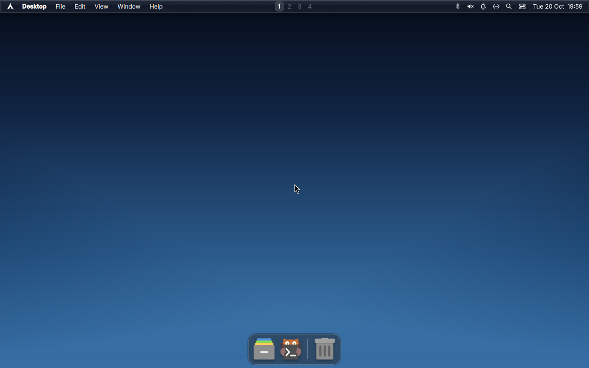
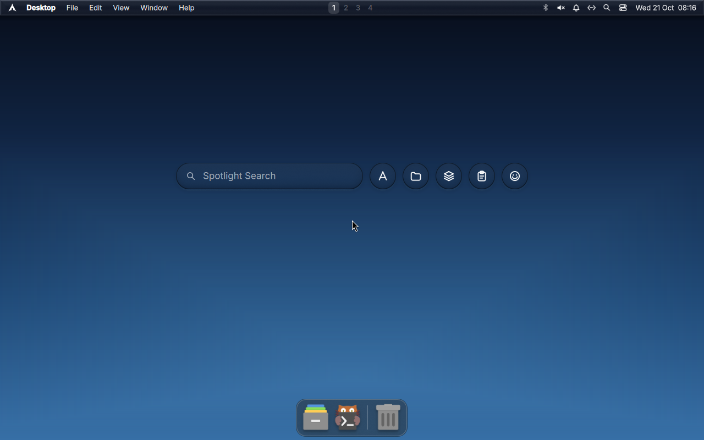
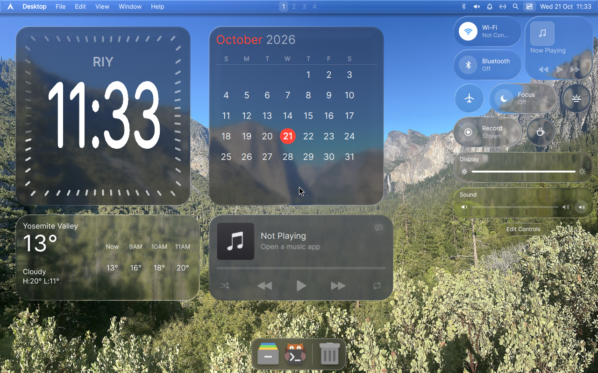
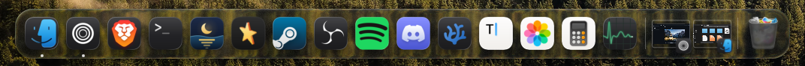
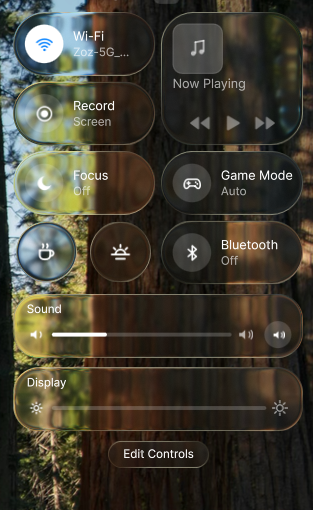

# Project Tahoe

An Arch Linux-based distribution with a macOS-Tahoe-styled Wayland desktop and a
single execution model for Linux ELF, Windows PE, macOS Mach-O/.app, AppImage
and DMG-delivered applications.



*The installed system after its first boot: Hyprland + MacShell 0.2.8, the
Yosemite wallpaper, desktop widgets and Dock. QEMU capture, 21 October 2026.*

**Where things stand:** [`docs/STATUS.md`](docs/STATUS.md) — what is
confirmed by running it, what is written but unverified, and what does not
work. Start there.

**Status: installable; the Rust desktop is still ahead.** The architecture,
tooling and seven working crates exist; their tests pass and the shell renders
real scenes with real text (see `TODO.md` for what is still ahead). The archiso
profile builds a bootable ISO that runs [Hyprland with a vendored MacShell
session](https://github.com/0-ss/MacShell) and installs with Calamares; a clean
install on the final image (CI run 39511318414) reached the installed desktop
without manual repairs. The Rust shell is still not a Wayland client — the ISO
uses the vendored shell. There is no release download yet; the ISO is a CI
artifact (see `docs/limitations.md`). See [ROADMAP.md](ROADMAP.md) for what
comes next.

---

## Read this first

Three things about Tahoe are easy to get wrong, so they are stated up front:

1. **It is not a compatibility guarantee.** Identifying a file as `Mach-O` and
   handing it to Darling is not "macOS apps work on Tahoe". Darling's own
   maintainers describe GUI AppKit support as minimal. Tahoe reports a
   *confidence* for every execution decision instead of a promise.
2. **Wine is not Windows, Darling is not macOS.** They are translation layers
   with documented, measurable gaps. See `ARCHITECTURE.md` §6.
3. **DMG is never executed.** It is a disk image. It is mounted and extracted.
   So is `.app` browsing, at the bundle level.

---

## The one idea

One session, one Dock, one file manager — and an honest answer to *"what
happens if I double-click this?"* for every kind of binary the user might
actually own.

```
                    ┌─────────────────────────────┐
   /Volumes/App.dmg │  tahoe-uel                  │
   foo.exe          │  probe → strategy → spawn   │──► native exec()
   Foo.app/…/Foo    │  …with a confidence report  │──► wine …            (Wine 11)
   program.AppImage │                             │──► darling …         (Darling)
   ./configure      │                             │──► /bin/sh …
                    └─────────────────────────────┘
```

---

## What is real today

| Component | State | Evidence |
|---|---|---|
| `tahoe-core` | ✅ implemented | `cargo test -p tahoe-core` |
| `tahoe-format` | ✅ implemented, 40+ tests | `cargo test -p tahoe-format` |
| `tahoe-uel` | ✅ implemented, pure decision logic | `cargo test -p tahoe-uel` |
| `tahoe-compositor` | ✅ compiles against Smithay 0.7 | `cargo build -p tahoe-compositor` |
| `tahoe-shell` | ✅ model implemented (dock/workspaces/launcher index) | `cargo test -p tahoe-shell` |
| `tahoe-diagnostics` | ✅ read-only probes | `cargo test -p tahoe-diagnostics` |
| `iso/` archiso profile + MacShell live session | ✅ built, boots, installs | CI run 39511318414; clean-install evidence in `docs/iso-installer.md` §9 |
| `packages/` PKGBUILDs | ✅ built into the ISO | `iso/build.sh` packages `tahoe-base`, `tahoe-compositor` and `tahoe-uel` from the checkout |
| `binfmt.d/` entries | ✅ active in the installed system; a dev host still needs root + consent | `systemctl status systemd-binfmt` in `docs/iso-installer.md` §9 |
| Tahoe Shell GUI | 🔴 not started | see ROADMAP |

The ISO has been built, booted and installed cleanly; the installed disk boots
to Hyprland + MacShell on its own (evidence: `docs/iso-installer.md` §9).
Host-side Wine/Proton PE runs have passed, but the ISO does not bundle Wine, so
a `.exe` inside the installed system needs Wine installed first. Not verified
yet: UEFI boot (the test host has no OVMF), Windows PE execution inside the
installed system, and Darling GUI apps. `docs/limitations.md` has the list.

## Screenshots

The first image is the installed system with no windows open. Two more views:

| Spotlight | Control Center |
|:---:|:---:|
| [](docs/images/tahoe-spotlight.png) | [](docs/images/tahoe-control-center.png) |

*Left: MacShell Spotlight (`SUPER+Space`) on the installed desktop. Right:
MacShell Control Center over the same wallpaper. Both are QEMU screendumps
(1280x800), 21 October 2026.*

### The MacShell upstream reference

These two detail shots come from the [MacShell repository's own
README](https://github.com/0-ss/MacShell#screenshots), by Rickky (`0-ss`).
They are included as upstream references for the Dock and Control Center, and
are not captures of Tahoe. The installed system ships the same 0.2.8 shell.

| MacShell Dock (upstream) | MacShell Control Center (upstream) |
|:---:|:---:|
|  |  |

The full verification record — including the login prompt, the binfmt rule and
the swaybg process — is in [`docs/iso-installer.md`](docs/iso-installer.md) §9.

---

## Quick start (development)

```sh
# Toolchain: Rust >= 1.87 — MSRV of Smithay 0.7 (see `rust-version` in Cargo.toml).
# No rustup pin file: the reference machine uses system cargo (1.99.0).
cargo test                        # all crates
cargo clippy --all-targets -- -D warnings
cargo fmt --all -- --check

# optional: the format probe CLI
cargo run -p tahoe-uel -- probe /bin/ls
cargo run -p tahoe-uel -- probe /path/to/installer.exe
```

Reference environment used for verification (CachyOS 6.18, Rust 1.99.0):
see [`docs/research/2026-10-13-smithay-build-verification.md`](docs/research/2026-10-13-smithay-build-verification.md).

---

## Repository map

```
crates/   Rust workspace — compositor, UEL, format parser, shell model
iso/      archiso profile — Hyprland + vendored MacShell live session
          (docs/iso-session.md, provenance in iso/macshell-vendor.md)
packages/ PKGBUILDs (sources 0BSD, per Arch policy)
binfmt.d/ binfmt_misc entries we ship
fixtures/ synthetic binaries for the format tests + generator
docs/     research findings, ADRs, testing strategy, README screenshots
```

Full detail in [ARCHITECTURE.md](ARCHITECTURE.md).

---

## Credits

Tahoe is assembled from other people's work. The projects and people below
shape the desktop, the installer and the execution model; this is attribution,
not a claim of authorship. Vendored code and notices are recorded in
[`NOTICE`](NOTICE), [`LICENSING.md`](LICENSING.md) and
[`iso/macshell-vendor.md`](iso/macshell-vendor.md).

**Desktop**

- **[MacShell](https://github.com/0-ss/MacShell)** / **MacLock** — Rickky
  ([0-ss](https://github.com/0-ss)), MIT. Menu bar, Dock, Spotlight, Control
  Center, widgets and lock screen; vendored unmodified at `eebaaad`
  (tag 0.2.8).
- **[Hyprland](https://hypr.land/)** — Vaxry ([vaxry](https://github.com/vaxry))
  and contributors, BSD-3-Clause. The Wayland compositor and its Lua
  configuration API.
- **[Quickshell](https://quickshell.org/)** — outfoxxed
  ([outfoxxed](https://github.com/outfoxxed)) and contributors, LGPL-3.0-only.
  The QtQuick runtime the MacShell session runs on.
- **[swaybg](https://github.com/swaywm/swaybg)** — the sway/wlroots
  contributors, MIT. The wallpaper daemon, run with the pixman renderer in VMs.
- **Yosemite Valley wallpaper** — EF5, CC0 1.0, via
  [Wikimedia Commons](https://commons.wikimedia.org/wiki/File:%E2%80%9CTunnel_View%E2%80%9D_overlook_showing_famous_rock_formations_in_Yosemite_Valley_03.jpg).
  Cropped and resized for the default dark wallpaper.
- **[Papirus](https://github.com/PapirusDevelopmentTeam/papirus-icon-theme)** —
  Papirus Development Team, GPL-3.0. Icon theme.
- **[Inter](https://rsms.me/inter/)** — Rasmus Andersson, SIL OFL 1.1.
- **[Noto](https://fonts.google.com/noto)** — Google and contributors, SIL OFL
  1.1.
- **[kitty](https://sw.kovidgoyal.net/kitty/)** — Kovid Goyal, GPL-3.0-only.

**Installer and base**

- **[Calamares](https://calamares.io/)** — the Calamares team and contributors,
  GPL-3.0-or-later. The graphical installer; the `tahoe` branding and module
  configuration are this project's.
- **[Arch Linux](https://archlinux.org/)** and
  **[archiso](https://github.com/archlinux/archiso)** — Arch Linux contributors,
  GPL-3.0-or-later for archiso; individual packages keep their own licenses.
- **[CachyOS](https://cachyos.org/)** — the Calamares-based installer follows
  the same upstream-plus-own-branding approach as CachyOS; no CachyOS code is
  imported. Thanks for the reference.

**Execution model**

- **[Wine](https://www.winehq.org/)** — WineHQ and contributors,
  LGPL-2.1-or-later. Windows PE execution, out of process; not bundled.
- **[Darling](https://www.darlinghq.org/)** — Darling contributors,
  GPL-3.0-or-later. Mach-O execution, out of process; not bundled.

The base system is assembled from Arch Linux packages; each package carries its
own copyright and license. The Tahoe screenshots are QEMU captures taken for
this project; the two `macshell-upstream-*` images are reproduced from the
MacShell README under its MIT license.

macOS and macOS Tahoe are trademarks of Apple Inc. Project Tahoe is an
independent tribute and is not affiliated with or endorsed by Apple. See
[`TRADEMARKS.md`](TRADEMARKS.md).

---

## Licensing

First-party code: **`MIT OR Apache-2.0`**.

Copyright © 2026 **[iboshka24](https://github.com/iboshka24) and Project Tahoe
contributors**. Individual contributors retain their rights. This repository is
the canonical upstream for this project.

- [License overview](LICENSE) and complete [MIT](LICENSES/MIT.txt) /
  [Apache-2.0](LICENSES/Apache-2.0.txt) terms.
- [Attribution and upstream notices](NOTICE).
- [Name, branding, and unofficial-fork guidelines](TRADEMARKS.md).

Licensed forks and commercial reuse are permitted. Preserve the notices required
by the license you choose, identify your modifications as required, and do not
present an unofficial fork as an official release or as work by iboshka24.
Branding guidelines do not add restrictions to the software licenses.

The interesting question is Darling, which is `GPL-3.0-or-later`. Tahoe keeps
it out of every first-party binary: compatibility layers are spawned as
separate processes and talked to over pipes/D-Bus. The full analysis — including
why this is both the legally safe boundary and the right engineering choice —
is in [LICENSING.md](LICENSING.md).

---

## Contributing

[CONTRIBUTING.md](CONTRIBUTING.md). Short version: keep the layer boundaries,
keep the honesty guarantees, add a test for every format claim you make.
