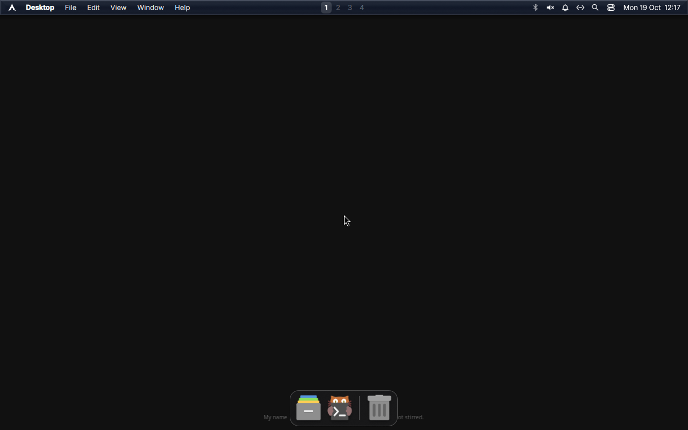

# Booting the ISO: what the first boot test found

> Status: **the shipped ISO did not boot. Three defects, all fixed, and the
> rebuilt ISO has since booted through the real bootloader to the desktop.**
> The evidence below is from QEMU, not from reading the profile.
>
> Date: 2026-10-19. Image under test:
> `tahoe-2026.10.18-x86_64.iso`, 1 739 030 528 bytes,
> `sha256 0037ca5ef4fd954718c2e5b7aadf37995e40bd81bdf1d71dc4af497c4027d278`,
> the artifact of CI run 39162703139.

---

## 1. How to boot it without root

No root, no `pacman`, no `libvirt`. QEMU comes from the virt-manager Flatpak
(a runtime extension), `/dev/kvm` is used directly, and the ISO is exposed to
the sandbox for one run with `flatpak run --filesystem=`:

```sh
tests/vm-boot.sh <iso> <outdir> [seconds]        # screenshots on a schedule
TAHOE_MACHINE=pc tests/vm-boot.sh …              # i440fx instead of q35
TAHOE_KERNEL=… TAHOE_INITRD=… TAHOE_APPEND=… \
    tests/vm-boot.sh …                           # direct kernel boot, serial log
tests/vm-probe.py <iso> <outdir> --commands "…"  # type at the guest, screenshot
tests/ppm-to-png.py <outdir>/*.ppm               # frames you can look at
tests/initramfs-ls.py <initramfs> <pattern>      # read an initramfs, all segments
```

`screendump` through the monitor works headless, so the whole loop runs over
ssh. `vm-probe.py` talks to a `-monitor unix:` socket and sends `sendkey`
events, which is how the emergency shell below was made to answer questions.

## 2. Defect 1 — the image did not boot at all

The kernel and initramfs load, the archiso hooks run, and then:

```
:: Mounting '' to '/run/archiso/bootmnt'
ERROR: '' device did not show up after 30 seconds...
    Falling back to interactive prompt
rootfs ~]#
```

The empty `''` is the whole story: the device path was the empty string.
It fails identically on `q35` and on `i440fx`, so it is not a driver problem —
which was the first hypothesis, and it was wrong.

**Cause, from the code that printed the error.** The initramfs's
`/hooks/archiso` reads:

```sh
archisolabel="$(getarg 'archisolabel')"
if [ -n "$archisolabel" ]; then
    archisodevice="$(getarg 'archisodevice' "/dev/disk/by-label/${archisolabel}")"
else
    archisodevice="$(getarg 'archisodevice')"
fi
```

The ISO's kernel command line said `img_label=TAHOE_202610`. `img_label` is
read by a *different* hook — `archiso_loop_mnt`, which boots from an ISO
**file** and only acts when `img_dev`/`img_label` **and** `img_loop` are both
present:

```sh
img_label=$(getarg 'img_label')
img_dev="$(getarg 'img_dev')"
[ -n "${img_label}" ] && img_dev="$(getarg 'img_dev' "/dev/disk/by-label/${img_label}")"
img_loop="$(getarg 'img_loop')"
if [ -n "${img_dev}" ] && [ -n "${img_loop}" ]; then
```

With no `img_loop`, that hook does nothing; with no `archisolabel`, the main
hook has no device. `img_label` is not a synonym for `archisolabel`, it is a
parameter of a different mechanism, and an unknown parameter is not an error
anywhere — it is ignored.

**The medium was fine.** Typing at the emergency shell (`vm-probe.py`) shows
the device present and correctly labelled:

```
rootfs ~]# blkid
/dev/sr0: BLOCK_SIZE="2048" UUID="2026-10-18-20-21-15-00" LABEL="TAHOE_202610" TYPE="iso9660" PTUUID="276efa76" PTTYPE="dos"
```

Fixed in `iso/syslinux/syslinux.cfg` and `iso/efiboot/loader/entries/tahoe.conf`:
`img_label=` → `archisolabel=`. `tests/check-iso.sh` now fails if either file
stops passing `archisolabel`, or sneaks `img_label` back in; the check was
verified to fail against the old line and pass against the new one.

## 3. Defect 2 — the desktop never started, even once the medium was found

With `archisolabel` corrected, the boot proceeds and stops here:

```
[  OK  ] Finished Create System Files and Directories.
         Starting Initial Setup...
Welcome to Arch Linux!
✨ Please configure the system!
🕗 Please enter the new timezone name or number or number ("list" to list options, empty to skip):
```

`mkarchiso` writes `/etc/machine-id` as the literal string `uninitialized` on
purpose, so systemd's first-boot mechanism applies and
`systemd-firstboot --prompt` runs. On an ordinary Arch ISO that is the point.
On a live image whose documented behaviour is "the live user lands in a fully
dressed desktop", it is a wall: the prompt holds the boot, `getty@tty1` never
reaches `~/.bash_profile`, and Hyprland never starts.

Fixed by adding `systemd.firstboot=no` to both boot entries. Confirmed by
booting again — see §5.

## 4. Defect 3 — the session config aborted halfway

With the first-boot prompt out of the way, the desktop appears (it really
does, §5) with an error banner from the compositor:

```
Your config has errors:
/home/tahoe/.config/hypr/hyprland.lua:100: attempt to call a nil value (field 'reload_config')
stack traceback:
        /home/tahoe/.config/hypr/hyprland.lua:100: in main chunk
```

Line 100 was `hl.bind("SUPER + SHIFT + R", hl.dsp.reload_config())`.
`hl.dsp.reload_config` is not a member of the dispatcher API as shipped, and a
Lua error **aborts the whole file**: the two `hl.exec_cmd` calls above it ran
(which is why MacShell is on screen at all), and every window rule and layer
rule below it never applied.

The bind is removed, with a comment saying why. The wider point stands: only
lines above 100 have ever executed. The rest of the file is unverified, and
a config that dies at the first unknown call hides its own tail.

## 5. What the second boot showed

Same command line, plus `systemd.firstboot=no`, direct-kernel boot so the log
is text on a serial line:

| Evidence | Result |
|---|---|
| `archisolabel` resolves the medium | ✔ the archiso hook mounts `/run/archiso/bootmnt` |
| The squashfs root mounts and boots | ✔ systemd reaches late boot, NetworkManager starts |
| The graphical session starts | ✔ Hyprland runs, a cursor is drawn, layer surfaces exist |
| MacShell renders | ✔ menu bar (logo, **Desktop**, File/Edit/View/Window/Help, workspace pills 1–4), clock `Mon 19 Oct 08:36`, status icons, and a centred Dock with Files/terminal/Trash |
| Frame stability over 260 s | ✔ 332 sampled colours at t=110 s and at t=260 s |



## 6. The rebuilt ISO, booted through the bootloader

CI rebuilt the image from the fixes (run 39229471074, 12m51s, all 67 profile
checks green) and it was booted the ordinary way — no `-kernel`, no `-append`,
just SeaBIOS handing control to the ISO's own syslinux:

| | |
|---|---|
| image | `tahoe-2026.10.19-x86_64.iso`, 1 739 030 528 bytes |
| sha256 | `791a38194ec254bda7c2b533db10390a18e8c482610bbeaf8e9e46bbe8da1749` |
| differs from the previous build | yes — `0037ca5e…` → `791a38…`, so the config change really is in the image |
| booted config, from inside the ISO | `APPEND archisobasedir=tahoe archisolabel=TAHOE_202610 systemd.firstboot=no` |
| result | no emergency shell; Hyprland starts and MacShell draws its menu bar, workspace pills, clock and Dock |
| error banner | **gone** — the `hyprland.lua:100` abort is fixed, so the window and layer rules below it now apply |


The same size as the previous build is expected and not a sign that nothing
changed: the edits are a few bytes inside a 1.6 GiB squashfs, and block
alignment absorbs them. The checksum is the check that matters.

## 7. Still true after all this

- **Nothing boots the EFI path yet.** The El Torito catalog has an EFI section
  (platform `0xef`), and `loader/entries/tahoe.conf` is fixed the same way as
  the syslinux one, but no UEFI firmware was available to this session
  (`edk2-ovmf` is not installed and the mirror was busy), so the UEFI side is
  fixed by inspection only.
- **The artifact expires.** CI uploads the ISO with `retention-days: 1`, and
  there is no GitHub Release, so the image stops being downloadable a day
  after it is built. A tag exists (`v0.1.0`); `gh release view v0.1.0` says
  `release not found`.

Two bullets that used to be here were fixed later: the binfmt failure (the
rule had been packaged from the `v0.1.0` tag, 18 commits behind the checkout;
run 39464290091 rebuilt from HEAD and `systemctl --failed` is empty) and the
unknown wallpaper (hyprpaper 0.8.4 cannot render on a GPU-less VM; see
[`iso-session.md`](iso-session.md) §2a).
